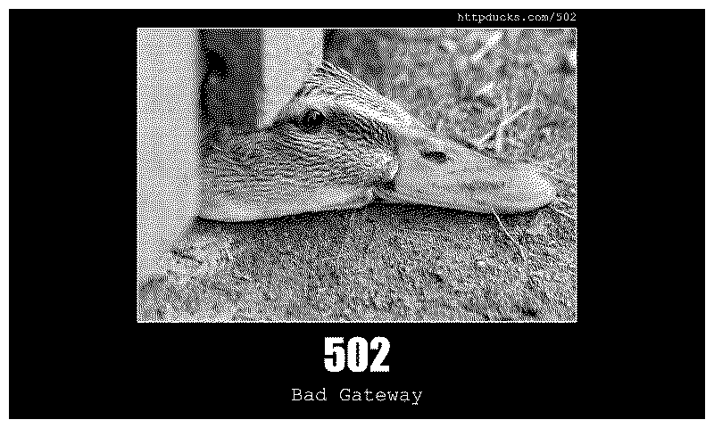

# HTTP Pets

HTTP status codes, delivered by a random animal on your TRMNL. Because a 502 Bad Gateway hurts slightly less when it's delivered by a confused duck.

<a href="https://trmnl.com/recipes/323180"></a>

[Install on TRMNL](https://trmnl.com/recipes/323180)



[All layout previews](TRMNL/README.md#previews).

## Settings

- **Choose your HTTP Pet:** `all`, `cats`, `httpcats`, `dogs`, `goats`, `ducks` or `fish` (defaults to `all`).
- No account or API key needed.

A new random image every 15 minutes, with full, half horizontal, half vertical and quadrant layouts. Force Refresh for another pet.

## Develop locally

Install [trmnlp](https://github.com/usetrmnl/trmnlp) with Node Serverless support, then run from the repository root:

```sh
cd TRMNL
trmnlp serve
```

Templates, settings and image selection live in [TRMNL/src/](TRMNL/src/). For setup and image tone calibration, see the [plugin guide](TRMNL/README.md#setup) and [script instructions](scripts/README.md).

Images from [HTTP Cats](https://http.cat/), [httpcats.com](https://httpcats.com/), [HTTP Dogs](https://http.dog/), [HTTP Goats](https://httpgoats.com/), [HTTP Ducks](https://httpducks.com/) and [HTTP Fish](https://http.fish/).

[Questions or ideas?](https://github.com/taichikuji/trmnl-http-pets-plugin/issues) · [License](LICENSE)
